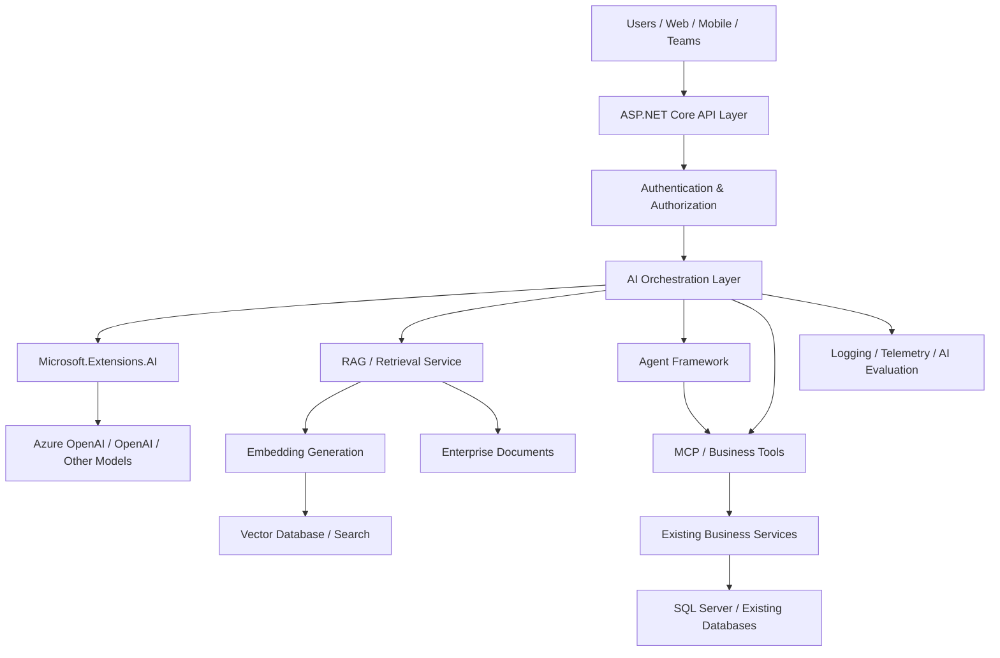

# The Future of .NET in the AI Era: From Traditional Backend Development to Intelligent Enterprise Applications

*How .NET developers can evolve from building traditional applications to engineering intelligent, AI-powered enterprise systems.*

## Introduction: Is .NET Ready for the AI Revolution?

AI is fundamentally changing the software development landscape. A few years ago, most enterprise applications were designed around predefined workflows, structured database queries, REST APIs, and business rules. Today, users increasingly expect applications to understand natural language, interpret documents, make intelligent recommendations, automate workflows, and interact with multiple systems.

This transformation raises an important question for the .NET community:

**Does the growing adoption of AI reduce the relevance of .NET, or does it create a new opportunity for .NET developers?**

My perspective is that .NET is entering an important new phase.

AI will change how applications are designed and how developers work, but the foundations of enterprise software engineering will remain critical. Security, scalability, reliability, data management, business logic, and system integration are not going away.

In fact, intelligent applications will depend on these capabilities more than ever.

Microsoft is investing heavily in bringing AI capabilities into the .NET ecosystem. With technologies such as Microsoft.Extensions.AI, Microsoft.Extensions.VectorData, Microsoft Agent Framework, and the Model Context Protocol (MCP) C# SDK, developers have an expanding toolkit for building AI-enabled applications.

With .NET 11 now released and .NET 10 continuing as an LTS option, the platform has a strong foundation for this transition.

**Let's explore what this means for developers, architects, and engineering leaders.**

## 1. .NET Is Evolving Beyond Traditional Application Development

For years, .NET has been a preferred technology for building enterprise applications, APIs, microservices, distributed systems, and cloud-native solutions.

Its strengths include:

- C# and a strongly typed programming model.
- ASP.NET Core for high-performance APIs and web applications.
- Entity Framework Core and database integration.
- Built-in dependency injection and configuration.
- Background processing and messaging integration.
- Authentication, authorization, and enterprise security.
- Cloud-native development and Azure integration.

These capabilities remain relevant in the AI era.

Consider a traditional customer management application.

Previously, its primary responsibilities might have been:

- Creating and updating customer records.
- Managing orders and transactions.
- Generating reports.
- Applying business rules.
- Exposing APIs to frontend applications.

Now imagine extending that application with AI capabilities.

It could also:

- Predict customers who may stop using a service.
- Identify unusual purchasing patterns.
- Summarize customer interactions.
- Recommend appropriate products.
- Answer questions using internal company documentation.
- Automate selected customer support workflows.

The important point is that the original application does not disappear. Its business logic, data, security, and integrations continue to operate.

AI adds an intelligent layer to existing capabilities.

**The future of .NET is not about replacing traditional application development. It is about extending traditional applications with intelligence.**

## 2. The Growing .NET AI Ecosystem

Microsoft is making AI integration increasingly accessible to C# developers.

Some of the most important components are worth understanding.

### Microsoft.Extensions.AI

This library provides common abstractions for interacting with AI services.

Two important interfaces are:

- `IChatClient` – provides a consistent abstraction for chat-based AI models.
- `IEmbeddingGenerator<TInput,TEmbedding>` – provides a common abstraction for generating embeddings.

The biggest advantage is reduced dependency on individual AI providers.

An application can use different model providers without making the entire business layer dependent on a particular vendor's SDK.

It also supports middleware capabilities such as logging, caching, telemetry, and tool invocation.

### Microsoft.Extensions.VectorData

AI applications often need to retrieve information based on meaning rather than exact keyword matches.

For example, a user might ask:

"What is the process for taking an extended vacation?"

The company's documentation may contain the heading "Long-term employee leave policy."

Traditional keyword searches may not identify the relationship effectively.

Vector search makes it possible to retrieve information based on semantic similarity.

Microsoft.Extensions.VectorData provides common abstractions for interacting with supported vector stores, including collection management and vector or hybrid search.

### Microsoft Agent Framework

A chatbot generally responds to a user's question.

An AI agent can go further by interacting with tools, retrieving information, and coordinating multiple steps to accomplish a task.

Microsoft Agent Framework provides capabilities for building agents and workflows, including integrations with model providers and MCP servers.

For example, an enterprise workflow could involve:

1. Receiving a customer request.
2. Retrieving the customer's information.
3. Checking applicable business policies.
4. Preparing a recommendation.
5. Requesting human approval.
6. Executing an authorized business operation.

This is where AI starts moving from answering questions to participating in business processes.

### Model Context Protocol (MCP)

MCP provides a standardized way for AI applications to connect with external tools and data sources.

A .NET developer can build MCP servers that expose selected business capabilities to compatible AI clients.

For example, an enterprise system could expose tools such as:

- GetCustomerDetails.
- CheckOrderStatus.
- RetrieveInvoice.
- CreateSupportTicket.
- GenerateSalesReport.

Rather than building a separate integration for every AI application, MCP provides a common interaction protocol.

It is important to remember that exposing a tool does not automatically make it safe. Authentication, authorization, input validation, and approval controls remain essential.

## 3. The Architecture of an AI-Powered .NET Enterprise Application

One of the biggest opportunities for .NET developers is integrating AI into existing enterprise architecture without replacing stable systems.

Consider a typical enterprise application with a frontend, ASP.NET Core APIs, business services, and a relational database.

We can extend it with an AI orchestration layer.

### Proposed architecture



*Original conceptual architecture: AI capabilities integrated with existing .NET enterprise services.*

### Understanding the architecture

**1. ASP.NET Core API layer**

The existing API layer remains the primary entry point for application requests. It manages request validation, authentication, authorization, and application boundaries.

**2. AI orchestration layer**

This layer coordinates AI interactions. It determines whether a request requires a model response, document retrieval, a business tool, or a combination of these capabilities.

**3. AI model integration**

Microsoft.Extensions.AI provides a consistent abstraction for interacting with supported AI model providers.

**4. RAG and vector search**

This component retrieves relevant information from enterprise documents and knowledge repositories.

**5. Agent and MCP integration**

Agents can coordinate tasks, while MCP provides standardized access to external tools and data sources.

**6. Existing business services**

Business operations continue to be executed through established services. AI should not bypass business rules or directly modify critical data without appropriate validation.

**7. Monitoring and evaluation**

AI responses need to be monitored for latency, cost, quality, failures, and security concerns.

This architecture allows organizations to introduce AI gradually while preserving their existing investments.

## 4. Building an AI-Powered ASP.NET Core API Using C#

Let's move from architecture to implementation.

Imagine an enterprise application that allows employees to ask questions about internal business processes.

For demonstration purposes, we will build a simple AI-powered API that accepts a question and returns an AI-generated response.

The example uses Microsoft.Extensions.AI with an OpenAI-compatible model provider.

### Step 1: Create the application

```bash
dotnet new webapi -n EnterpriseAI
cd EnterpriseAI
```

Install the required packages:

```bash
dotnet add package Microsoft.Extensions.AI
dotnet add package Microsoft.Extensions.AI.OpenAI
```

### Step 2: Configure the AI service

Set the API key as an environment variable:

```bash
OPENAI_API_KEY=your-api-key
```

For production, use a secure secret store rather than committing credentials to source control.

### Step 3: Implement the AI service

Replace the application entry point with the following minimal implementation:

```csharp
using Microsoft.Extensions.AI;
using OpenAI;
using OpenAI.Chat;

var builder = WebApplication.CreateBuilder(args);

var apiKey = builder.Configuration["OPENAI_API_KEY"]
    ?? throw new InvalidOperationException(
        "OPENAI_API_KEY is not configured.");

var chatClient = new ChatClient(
    model: "gpt-4o-mini",
    apiKey: apiKey);

builder.Services.AddChatClient(
    chatClient.AsIChatClient());

var app = builder.Build();

app.MapPost("/api/ai/ask",
    async (
        AskRequest request,
        IChatClient aiClient,
        CancellationToken cancellationToken) =>
    {
        if (string.IsNullOrWhiteSpace(request.Question))
        {
            return Results.BadRequest(
                new { Error = "Question is required." });
        }

        var response = await aiClient.GetResponseAsync(
            request.Question,
            cancellationToken: cancellationToken);

        return Results.Ok(new
        {
            Question = request.Question,
            Answer = response.Text
        });
    });

app.Run();

public record AskRequest(string Question);
```

Add the `OPENAI_API_KEY` configuration through your environment or secure configuration provider. The model name must match a model available to your provider.

### Step 4: Test the API

Send a POST request:

```http
POST /api/ai/ask
Content-Type: application/json

{
  "question": "Explain the benefits of microservices architecture."
}
```

The application sends the question to the configured AI model and returns its response.

### What does this demonstrate?

Notice that the endpoint depends on `IChatClient`, rather than directly depending on a provider-specific client.

This separation is important.

The application can evolve to use a different compatible provider without rewriting the entire API layer.

For production use, add request-size limits, rate limiting, authentication, timeouts, cancellation handling, structured error handling, and usage monitoring.

Also remember that AI-generated responses are not guaranteed to be accurate. Business-critical answers need appropriate validation and evaluation.

## 5. RAG: Making AI Understand Enterprise Data

One of the most useful AI capabilities for enterprise applications is Retrieval-Augmented Generation (RAG).

A general-purpose AI model does not automatically know an organization's private policies, product documentation, or internal business processes.

RAG addresses this limitation by retrieving relevant information from an organization's data sources before generating a response.

### Example: An internal HR assistant

Imagine an organization has thousands of documents containing:

- Employee policies.
- Leave policies.
- Insurance guidelines.
- Payroll procedures.
- Employee handbooks.
- Internal FAQs.

An employee asks:

"How many days of leave can I carry forward to the next financial year?"

A RAG-enabled application performs the following steps:

1. Searches the organization's indexed documents.
2. Retrieves the most relevant sections.
3. Passes those sections as context to the AI model.
4. Generates an answer based on the retrieved information.
5. Returns the answer along with appropriate document references.

The typical RAG pipeline looks like this:

**Document ingestion → Text extraction → Chunking → Embedding generation → Vector storage → Semantic retrieval → AI response**

For a .NET implementation, developers can combine Microsoft.Extensions.AI, Microsoft.Extensions.VectorData, and an appropriate vector-store provider.

A particularly important enterprise consideration is document-level authorization.

If an employee does not have permission to access a confidential HR or financial document, the retrieval system must not expose that information through an AI response.

RAG improves grounding, but it does not guarantee correctness. Retrieved content must still be checked for relevance, freshness, and access permissions.

## 6. From Chatbots to Autonomous AI Agents

The next evolution is moving from conversational applications to agent-based systems.

A chatbot generally answers questions. An agent can use tools to perform tasks.

Consider an order management application.

A user asks:

"Find my delayed orders and prepare a customer communication."

An agent-based workflow could:

1. Identify the customer.
2. Retrieve the customer's orders.
3. Check shipment status.
4. Identify delayed orders.
5. Draft an appropriate customer communication.
6. Ask an employee to approve the communication.
7. Send it through an authorized business service after approval.

This is significantly more powerful than a traditional chatbot.

However, the distinction between recommending an action and executing an action is critical.

An AI agent should not be granted unrestricted access to enterprise databases or financial operations.

A better approach is to expose narrowly scoped business tools with explicit permissions, audit logging, validation, and human approval for sensitive actions.

Microsoft Agent Framework provides building blocks for implementing agentic workflows and coordinating tools.

The opportunity for .NET developers is to combine these capabilities with existing enterprise services rather than create disconnected AI systems.

## 7. AI Security, Governance, and Enterprise Challenges

AI adoption introduces challenges that traditional application development teams must understand.

Building an AI-powered application is not simply a matter of connecting an API to an AI model.

Some important considerations include:

**Data privacy**

Sensitive business information should not be exposed to unauthorized AI providers or users. Organizations must understand their provider's data handling, retention, and compliance terms.

**Prompt injection**

Malicious instructions embedded in user input or retrieved documents may attempt to manipulate AI behavior.

Applications need clear trust boundaries and should not treat retrieved content as executable instructions.

**Authorization**

AI tools should operate under appropriately scoped permissions. A model's ability to identify an action must not automatically grant it permission to execute that action.

**Hallucinations**

AI models can produce convincing but incorrect responses. Important decisions must be grounded in verified data and appropriate business rules.

**Cost management**

Model usage can become expensive as request volume and context size increase. Caching, model selection, token limits, and monitoring should be part of the architecture.

**Latency and reliability**

AI services introduce external dependencies. Applications should handle timeouts, rate limits, retries where appropriate, and service failures gracefully.

**Observability and evaluation**

Traditional application monitoring is not sufficient on its own. AI systems also need evaluation of response quality, relevance, groundedness, and safety.

These concerns should be addressed during architecture design, not after the application reaches production.

## 8. How AI Will Change the Role of .NET Developers

AI coding assistants are already changing software development practices.

Developers can use AI to:

- Generate boilerplate code.
- Create unit tests.
- Explain unfamiliar codebases.
- Suggest refactoring improvements.
- Identify potential defects.
- Generate documentation.
- Assist with debugging and application modernization.

But software engineering involves much more than writing code.

Understanding requirements, designing distributed systems, managing technical debt, protecting data, and ensuring production reliability remain essential responsibilities.

The developer's role will increasingly move toward reviewing, validating, integrating, and orchestrating AI-assisted solutions.

I believe the real competitive advantage will come from combining strong engineering fundamentals with the ability to use AI effectively.

## 9. What Should .NET Developers Learn?

The following roadmap can help developers prepare for this transition.

| Area | Recommended learning |
|---|---|
| Modern .NET | .NET 10 LTS and .NET 11 STS |
| C# | Modern language features, async programming, performance |
| Backend development | ASP.NET Core, APIs, microservices |
| AI integration | Microsoft.Extensions.AI |
| AI fundamentals | LLMs, tokens, embeddings, prompting |
| Enterprise AI | Azure AI services and Microsoft Foundry |
| RAG | Vector search, document ingestion, retrieval |
| Agents | Microsoft Agent Framework |
| Integration | MCP and tool calling |
| Cloud | Azure, containers, .NET Aspire |
| Security | Identity, data protection, AI governance |
| Quality | AI evaluation, observability, testing |

Developers do not need to become machine learning researchers to build valuable AI applications.

They need to understand how AI works, where its limitations exist, and how to integrate it into reliable software systems.

## 10. The Next Five Years: Where Is .NET Heading?

Looking ahead, I expect several developments to shape enterprise software engineering.

**AI-native applications:** AI will increasingly become a core application capability rather than an additional chatbot interface.

**Natural-language interaction:** Users will increasingly interact with business systems using conversational interfaces alongside traditional screens.

**Intelligent automation:** AI agents will assist with multi-step workflows, with permissions and human approval controlling sensitive actions.

**AI-assisted engineering:** Coding, testing, debugging, and modernization will become increasingly AI-assisted.

**Hybrid architectures:** Existing enterprise applications will evolve by combining deterministic business services with AI-powered capabilities.

**Security and governance:** Data protection, auditability, model evaluation, and controlled execution will become central architectural concerns.

These are my predictions, not guaranteed outcomes. The pace of adoption will depend on business value, regulation, cost, and the maturity of AI technologies.

## Conclusion: The Future of .NET Is Intelligent, Not Obsolete

The AI revolution does not make traditional software engineering irrelevant.

If anything, it increases the importance of good architecture, reliable application design, secure data access, and strong engineering practices.

AI models need applications around them. Those applications need APIs, databases, authentication, authorization, business rules, monitoring, and integration with existing enterprise systems.

.NET provides a mature foundation for building these systems, and Microsoft's growing AI ecosystem gives developers additional ways to extend that foundation.

For existing .NET developers, this is an opportunity to evolve rather than start over.

Learn Microsoft.Extensions.AI. Experiment with RAG. Build an AI-enabled API. Explore MCP. Understand agentic workflows. Integrate AI into an existing enterprise application.

Most importantly, focus on solving genuine business problems rather than adopting AI simply because it is trending.

**The next generation of successful software engineers will not just build applications. They will build intelligent systems that combine the reliability of traditional software engineering with the capabilities of artificial intelligence.**

And I believe .NET will remain an important part of that journey.

---

*Disclaimer: This article reflects a technical perspective on the evolution of .NET and AI. Product capabilities and APIs evolve, so always check the linked documentation for current package versions and implementation details.*
