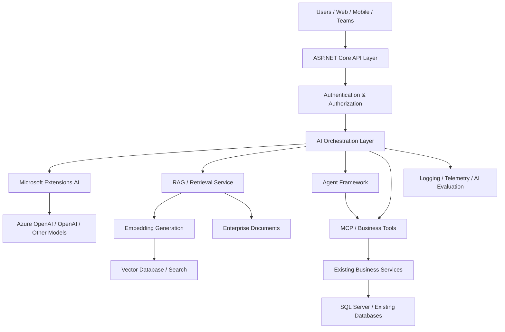

# The Future of .NET in the AI Era: From Traditional Backend Development to Intelligent Enterprise Applications

*How .NET developers can build on the skills they already have to create practical, secure, AI-powered enterprise systems.*

## Introduction: Is .NET Ready for the AI Revolution?

AI is fundamentally changing the software development landscape. A few years ago, a typical enterprise application was built around forms, predefined workflows, structured database queries, REST APIs, and business rules. Those foundations still matter, but users now expect more. They want to ask questions in natural language, search across documents, receive useful recommendations, summarize long conversations, and automate routine work.

That shift raises a fair question for the .NET community:

> **Does the growing adoption of AI reduce the relevance of .NET, or does it create a new opportunity for .NET developers?**

My perspective is that .NET is entering an important new phase.

AI will change how we design applications and how developers work. It will not remove the need for secure APIs, reliable services, clean domain models, data governance, observability, or system integration. If anything, an AI-enabled application depends on those capabilities more than a traditional one does. A model can generate a convincing response, but the surrounding application must still decide what data the model may access, which business operations it may perform, and how the result should be validated.

Microsoft is bringing AI capabilities closer to the .NET ecosystem through tools such as `Microsoft.Extensions.AI`, `Microsoft.Extensions.VectorData`, Microsoft Agent Framework, and the Model Context Protocol (MCP) C# SDK.

With .NET 11 available and .NET 10 continuing as an LTS option, .NET developers have a strong platform for making this transition.

> **The opportunity, as I see it, is not to abandon traditional back-end development. It is to combine the engineering discipline we already have with a new set of AI capabilities.**

**Let's explore what this means for developers, architects, and engineering leaders.**

## 1. .NET Is Evolving Beyond Traditional Application Development

For years, teams have used .NET to build enterprise applications, APIs, microservices, distributed systems, and cloud-native services. Its familiar strengths include:

- C# and a strongly typed programming model
- ASP.NET Core for high-performance APIs and web applications
- Entity Framework Core and mature database integration
- Built-in dependency injection, configuration, and logging
- Background services and messaging integration
- Authentication, authorization, and enterprise security
- Cloud-native deployment and close integration with Azure

None of these strengths loses value because an application includes AI.

Take a customer-management system as an example. Traditionally, it might:

- Create and update customer records
- Manage orders and transactions
- Apply pricing and eligibility rules
- Generate reports
- Expose APIs to web and mobile applications

An AI-enabled version could also:

- Summarize a customer's recent interactions
- Identify unusual purchasing patterns
- Predict customers who may stop using a service
- Recommend relevant products or next actions
- Answer questions from approved internal documentation
- Help a support agent prepare a response
- Start a workflow that a human reviews before execution

The important point is that the original application does not disappear. Its business logic, data, security, and integrations continue to operate. AI adds an intelligent layer to existing 
capabilities.

This distinction matters. I would not ask a language model to calculate an invoice, determine an entitlement, or update a critical record from its own interpretation. Those responsibilities should remain in deterministic business services. The model can help understand the user's intent, locate supporting information, or prepare a recommendation. The application should remain the authority for business rules and state changes.

> **The future of .NET is not about replacing traditional application development. It is about extending well-engineered applications with useful intelligence.**

## 2. The Growing .NET AI Ecosystem

The .NET AI ecosystem is developing quickly, but a few components are especially relevant to enterprise developers.

### Microsoft.Extensions.AI

`Microsoft.Extensions.AI` provides common abstractions for integrating AI services into .NET applications. Two important interfaces are:

- `IChatClient` for chat-based model interactions
- `IEmbeddingGenerator` for generating embeddings

The main benefit is architectural separation. Instead of allowing a provider-specific SDK to spread through the business layer, we can place the model behind a consistent interface. That makes the application easier to test and gives the team more flexibility if model, hosting, or provider requirements change.

> **My recommendation is to keep this integration boundary narrow. A domain service should not need to know about prompts, token limits, or provider response objects unless that knowledge is genuinely part of its responsibility.**

### Microsoft.Extensions.VectorData

AI applications often need to retrieve information based on meaning rather than exact keyword matches.

Suppose an employee asks:

> **“What is the process for taking an extended vacation?”**

The relevant document may be titled “Long-term employee leave policy.” A keyword search may miss that relationship, while a vector or hybrid search can retrieve it based on semantic similarity.

`Microsoft.Extensions.VectorData` provides common abstractions for supported vector stores, including collection management and vector or hybrid search. This can reduce store-specific code, but it does not remove the need to design retrieval carefully.

The quality of a retrieval system still depends on decisions such as:

- How documents are cleaned and divided into chunks
- Which metadata is stored with each chunk
- How user permissions are applied during retrieval
- Whether semantic, keyword, or hybrid search is appropriate
- How many results are returned and reranked
- How outdated content is removed or re-indexed

> **Choosing a vector database is only one part of the solution. In practice, content quality, metadata, and permission-aware retrieval often matter more than the database product itself.**

### Microsoft Agent Framework

A chatbot usually responds to a question. An agent can go further by selecting tools, retrieving information, and coordinating several steps toward a goal.

For example, an enterprise workflow might:

1. Receive a customer request.
2. Retrieve the customer's record.
3. Check the relevant policy.
4. Prepare a recommendation.
5. Ask a person to approve the action.
6. Call an authorized business service.
7. Record the result for audit and follow-up.

Microsoft Agent Framework provides capabilities for building agents and workflows, including model integrations and connections to MCP servers.

> **Agents are useful, but I would not make every workflow agentic. If the path is already known—validate input, call two services, request approval, and update a record—a deterministic workflow is usually easier to test, operate, and audit. Agentic behavior makes more sense when the system must interpret an ambiguous request, choose from several legitimate tools, or adapt the sequence based on intermediate results.**

### Model Context Protocol (MCP)

MCP provides a standard way for AI applications to discover and interact with tools and data sources. A .NET team can build an MCP server that exposes selected business capabilities such as:

- `GetCustomerDetails`
- `CheckOrderStatus`
- `RetrieveInvoice`
- `CreateSupportTicket`
- `GenerateSalesReport`

The advantage is that compatible AI clients can use a common interaction protocol instead of requiring a separate custom integration for each client. It is important to remember that exposing a tool does not automatically make it safe. Authentication, authorization, input validation, and approval controls remain essential.

> **I think of MCP as an integration contract, not as a security boundary. The underlying business service must remain responsible for protecting the operation.**

## 3. The Architecture of an AI-Powered .NET Enterprise Application

One of the biggest opportunities for .NET developers is integrating AI into existing enterprise architecture without replacing stable systems. Consider a typical enterprise application with a front-end, ASP.NET Core APIs, business services, and a relational database.

We can extend it with an AI orchestration layer.

### Proposed architecture



*Original conceptual architecture: AI capabilities integrated with existing .NET enterprise services.*

### Understanding the architecture

- **ASP.NET Core API layer:** The API layer remains the entry point for requests. It handles request validation, identity, authorization, throttling, and application boundaries. It should not treat model output as trusted simply because the response came from an internal service.

- **AI orchestration layer:** This layer coordinates AI interactions. It determines whether a request requires a model response, document retrieval, a business tool, or a combination of these capabilities.

- **AI model integration:** Microsoft.Extensions.AI provides a consistent abstraction for interacting with supported AI model providers.

- **RAG and vector search:** This component retrieves relevant information from enterprise documents and knowledge repositories.

- **Agent and MCP integration:** Agents can coordinate tasks, while MCP provides standardized access to external tools and data sources.

- **Existing business services:** Business operations continue to be executed through established services. AI should not bypass business rules or directly modify critical data without appropriate validation.

- **Monitoring and evaluation:** AI responses need to be monitored for latency, cost, quality, failures, and security concerns.

> **This architecture allows organizations to introduce AI gradually while preserving their existing investments.**

## 4. Building an AI-Powered ASP.NET Core API Using C#

Let's move from architecture to implementation.

Imagine an enterprise application that allows employees to ask questions about internal business processes.

For demonstration purposes, we will build a simple AI-powered API that accepts a question and returns an AI-generated response.

The example uses `Microsoft.Extensions.AI` with an OpenAI-compatible model provider.

### Step 1: Create the application

```bash
dotnet new webapi -n EnterpriseAI
cd EnterpriseAI
```

Install the required packages:

```bash
dotnet add package Microsoft.Extensions.AI
dotnet add package Microsoft.Extensions.AI.OpenAI
```

### Step 2: Configure the AI service

Set the API key as an environment variable:

```bash
OPENAI_API_KEY=your-api-key
```

For production, use a secure secret store rather than committing credentials to source control.

### Step 3: Implement the AI service

Replace the application entry point with the following minimal implementation:

```csharp
using Microsoft.Extensions.AI;
using OpenAI;
using OpenAI.Chat;

var builder = WebApplication.CreateBuilder(args);

var apiKey = builder.Configuration["OPENAI_API_KEY"]
    ?? throw new InvalidOperationException(
        "OPENAI_API_KEY is not configured.");

var chatClient = new ChatClient(
    model: "gpt-4o-mini",
    apiKey: apiKey);

builder.Services.AddChatClient(
    chatClient.AsIChatClient());

var app = builder.Build();

app.MapPost("/api/ai/ask",
    async (
        AskRequest request,
        IChatClient aiClient,
        CancellationToken cancellationToken) =>
    {
        if (string.IsNullOrWhiteSpace(request.Question))
        {
            return Results.BadRequest(
                new { Error = "Question is required." });
        }

        var response = await aiClient.GetResponseAsync(
            request.Question,
            cancellationToken: cancellationToken);

        return Results.Ok(new
        {
            Question = request.Question,
            Answer = response.Text
        });
    });

app.Run();

public record AskRequest(string Question);
```

Add the `OPENAI_API_KEY` configuration through your environment or secure configuration provider. The model name must match a model available to your provider.

### Step 4: Test the API

Send a POST request:

```http
POST /api/ai/ask
Content-Type: application/json

{
  "question": "Explain the benefits of micro-services architecture."
}
```

The application sends the question to the configured AI model and returns its response.

### What does this demonstrate?

- Notice that the endpoint depends on `IChatClient`, rather than directly depending on a provider-specific client.

- This separation is important.

- The application can evolve to use a different compatible provider without rewriting the entire API layer.

- For production use, add request-size limits, rate limiting, authentication, timeouts, cancellation handling, structured error handling, and usage monitoring.

> **Also remember that AI-generated responses are not guaranteed to be accurate. Business-critical answers need appropriate validation and evaluation.**

## 5. RAG: Making AI Understand Enterprise Data

One of the most useful AI capabilities for enterprise applications is Retrieval-Augmented Generation (RAG).

A general-purpose model does not know an organization's current policies, contracts, product manuals, support history, or internal procedures. RAG addresses that gap by retrieving relevant enterprise content and providing it to the model at request time.

### Example: An internal HR assistant

Imagine an organization has thousands of documents containing:

- Employee policies.
- Leave policies.
- Insurance guidelines.
- Payroll procedures.
- Employee handbooks.
- Internal FAQs.

An employee asks:

"How many days of leave can I carry forward to the next financial year?"

A RAG-enabled application performs the following steps:

1. Searches the organization's indexed documents.
2. Retrieves the most relevant sections.
3. Passes those sections as context to the AI model.
4. Generates an answer based on the retrieved information.
5. Returns the answer along with appropriate document references.

The typical RAG pipeline looks like this:

> **Document ingestion → Text extraction → Chunking → Embedding generation → Vector storage → Semantic retrieval → AI response**

For a .NET implementation, developers can combine `Microsoft.Extensions.AI`, `Microsoft.Extensions.VectorData`, and an appropriate vector-store provider.

A particularly important enterprise consideration is document-level authorization. If an employee does not have permission to access a confidential HR or financial document, the retrieval system must not expose that information through an AI response.

> **RAG improves grounding, but it does not guarantee correctness. Retrieved content must still be checked for relevance, freshness, and access permissions.**

## 6. From Chatbots to Autonomous AI Agents

The next evolution is moving from conversational applications to agent-based systems. A chatbot generally answers questions. An agent can use tools to perform tasks.

Consider an order management application. A user asks:

"Find my delayed orders and prepare a customer communication."

An agent-based workflow could:

1. Identify the customer.
2. Retrieve the customer's orders.
3. Check shipment status.
4. Identify delayed orders.
5. Draft an appropriate customer communication.
6. Ask an employee to approve the communication.
7. Send it through an authorized business service after approval.

This is significantly more powerful than a traditional chatbot. However, the distinction between recommending an action and executing an action is critical.

An AI agent should not be granted unrestricted access to enterprise databases or financial operations. A better approach is to expose narrowly scoped business tools with explicit permissions, audit logging, validation, and human approval for sensitive actions.

> **NOTE:**
> - Microsoft Agent Framework provides building blocks for implementing agentic workflows and coordinating tools.
> - The opportunity for .NET developers is to combine these capabilities with existing enterprise services rather than create disconnected AI systems.

## 7. AI Security, Governance, and Enterprise Challenges

AI adoption introduces challenges that traditional application development teams must understand. Building an AI-powered application is not simply a matter of connecting an API to an AI model. Some important considerations include:

- **Data privacy:** Sensitive business information should not be exposed to unauthorized AI providers or users. Organizations must understand their provider's data handling, retention, and compliance terms.

- **Prompt injection:** Malicious instructions embedded in user input or retrieved documents may attempt to manipulate AI behavior. Applications need clear trust boundaries and should not treat retrieved content as executable instructions.

- **Authorization:** AI tools should operate under appropriately scoped permissions. A model's ability to identify an action must not automatically grant it permission to execute that action.

- **Hallucinations:** AI models can produce convincing but incorrect responses. Important decisions must be grounded in verified data and appropriate business rules.

- **Cost management:** Model usage can become expensive as request volume and context size increase. Caching, model selection, token limits, and monitoring should be part of the architecture.

- **Latency and reliability:** AI services introduce external dependencies. Applications should handle timeouts, rate limits, retries where appropriate, and service failures gracefully.

- **Observability and evaluation:** Traditional application monitoring is not sufficient on its own. AI systems also need evaluation of response quality, relevance, groundedness, and safety.

> **NOTE:** Security is not a final checklist item for an AI feature. It shapes the architecture from the beginning and these concerns should be addressed during architecture design, not after the application reaches production.

## 8. How AI Will Change the Role of .NET Developers

I do not believe AI makes .NET developers irrelevant. I do think the role will broaden.

A .NET developer who already understands APIs, domain logic, identity, messaging, databases, and distributed systems has much of the foundation needed for AI application engineering. The new skills sit on top of that base.

Developers can use AI to:

- Generate boilerplate code.
- Create unit tests.
- Explain unfamiliar codebases.
- Suggest refactoring improvements.
- Identify potential defects.
- Generate documentation.
- Assist with debugging and application modernization.

But software engineering involves much more than writing code. Understanding requirements, designing distributed systems, managing technical debt, protecting data, and ensuring production reliability remain essential responsibilities.

> - **The developer's role will increasingly move toward reviewing, validating, integrating, and orchestrating AI-assisted solutions.**
> - **I believe the real competitive advantage will come from combining strong engineering fundamentals with the ability to use AI effectively.**

## 9. What Should .NET Developers Learn?

The following roadmap can help developers prepare for this transition.

| Area | Recommended learning |
|---|---|
| Modern .NET | .NET 10 LTS and .NET 11 STS |
| C# | Modern language features, async programming, performance |
| Backend development | ASP.NET Core, APIs, microservices |
| AI integration | Microsoft.Extensions.AI |
| AI fundamentals | LLMs, tokens, embeddings, prompting |
| Enterprise AI | Azure AI services and Microsoft Foundry |
| RAG | Vector search, document ingestion, retrieval |
| Agents | Microsoft Agent Framework |
| Integration | MCP and tool calling |
| Cloud | Azure, containers, .NET Aspire |
| Security | Identity, data protection, AI governance |
| Quality | AI evaluation, observability, testing |

> **Developers do not need to become machine learning researchers to build valuable AI applications. They need to understand how AI works, where its limitations exist, and how to integrate it into reliable software systems.**

## 10. The Next Five Years: Where Is .NET Heading?

Looking ahead, I expect several developments to shape enterprise software engineering.

- **AI-native applications:** AI will increasingly become a core application capability rather than an additional chatbot interface.

- **Natural-language interaction:** Users will increasingly interact with business systems using conversational interfaces alongside traditional screens.

- **Intelligent automation:** AI agents will assist with multi-step workflows, with permissions and human approval controlling sensitive actions.

- **AI-assisted engineering:** Coding, testing, debugging, and modernization will become increasingly AI-assisted.

- **Hybrid architectures:** Existing enterprise applications will evolve by combining deterministic business services with AI-powered capabilities.

- **Security and governance:** Data protection, auditability, model evaluation, and controlled execution will become central architectural concerns.

> **These are my predictions, not guaranteed outcomes. The pace of adoption will depend on business value, regulation, cost, and the maturity of AI technologies.**

## Conclusion: The Future of .NET Is Intelligent, Not Obsolete

The AI revolution does not make traditional software engineering irrelevant. The core responsibilities of enterprise engineering remain the same: protect data, enforce business rules, integrate systems, handle failure, observe production behavior, and deliver something users can trust. AI adds new possibilities, but it also adds uncertainty. That makes sound architecture more important, not less.

For .NET developers, the practical path is straightforward:

- Keep strengthening the engineering foundation.
- Learn the model and retrieval abstractions available in the .NET ecosystem.
- Start with a small, bounded use case.
- Evaluate quality with real examples.
- Keep authorization, validation, and business rules outside the model.
- Add tools and agents only where they provide clear value.
- Design for human oversight, observability, latency, and cost from the beginning.

The developers who combine AI knowledge with strong enterprise engineering judgment will be well placed for the next phase of software development. The goal is not to turn every application into a chatbot or every workflow into an agent. The goal is to use AI where it makes the product genuinely more useful—and to do it without giving up the reliability and control that enterprise systems require.

> **The next generation of successful software engineers will not just build applications. They will build intelligent systems that combine the reliability of traditional software engineering with the capabilities of artificial intelligence.**
> 
> **And I believe .NET will remain an important part of that journey.**

---

*Disclaimer: This article reflects a technical perspective on the evolution of .NET and AI. Product capabilities and APIs evolve, so always check the linked documentation for current package versions and implementation details.*
